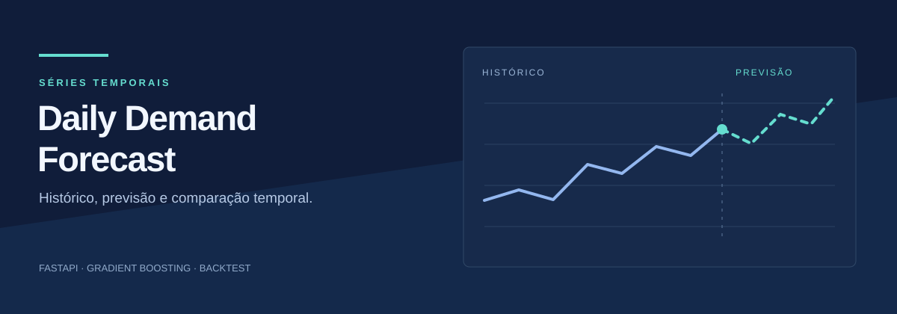
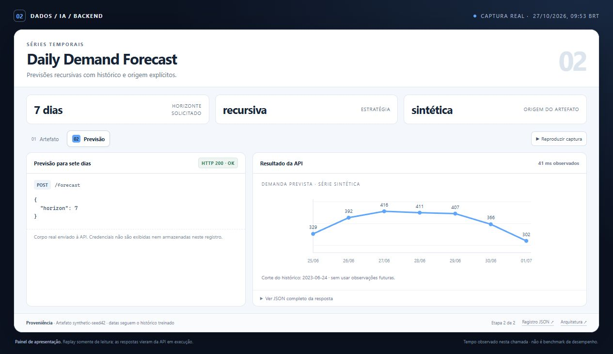
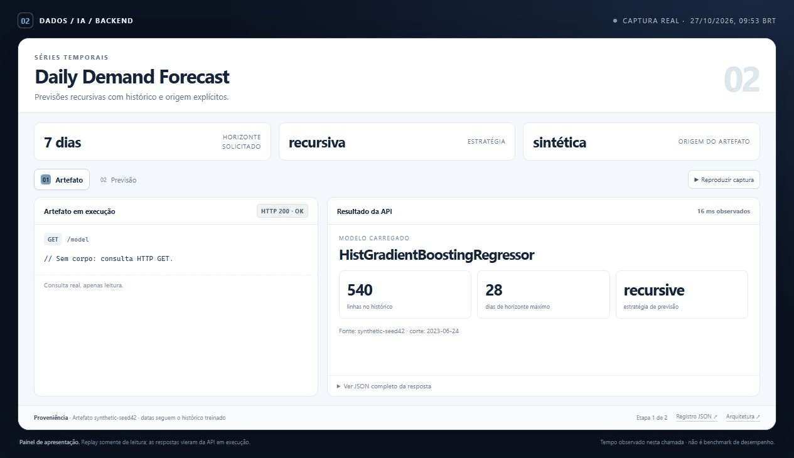
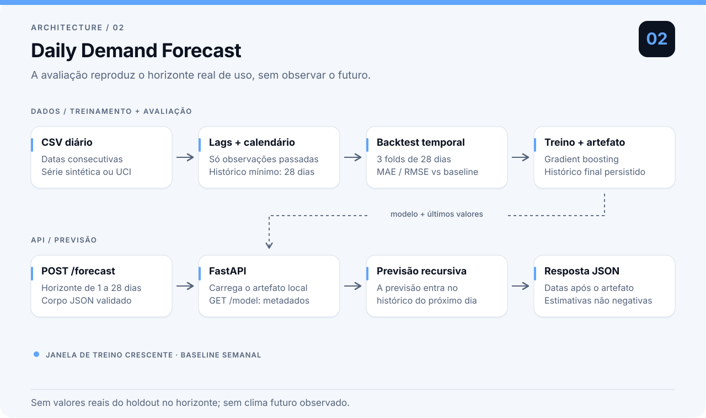
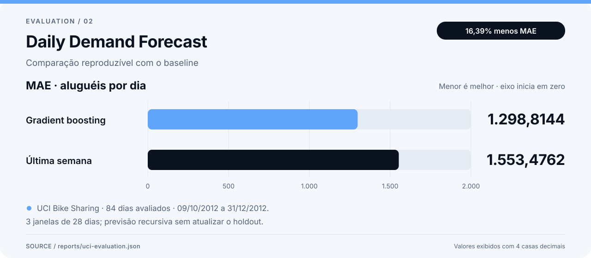

# Daily Demand Forecast

Prevê a demanda diária de bicicletas de um a 28 dias à frente. O backtest reproduz a previsão recursiva da API, usando apenas o histórico disponível e comparando o modelo com a repetição da última semana.

**Competência principal:** Séries temporais.

| IA implementada | Backend | Dados da demonstração | Verificação local |
| --- | --- | --- | --- |
| Boosting com lags causais | FastAPI · artefato versionado | Demo sintética + avaliação pública UCI | 22 testes aprovados |

[Demonstração e captura](docs/PRESENTATION.md) · [Resultado registrado](reports/uci-evaluation.json) · [Plano de commits](COMMITS.txt)

## Demonstração

Painel de demonstração com respostas reais da API. A apresentação organiza requisições, resultados e verificações da execução registrada.

| Captura no navegador | Demonstração animada |
| :---: | :---: |
|  |  |

[Abrir painel local em HTML](docs/demo/index.html) · [Consultar requests, respostas e timestamps](docs/demo/run.json) · [Ver o contrato no Swagger](docs/assets/api-docs.jpg)

Os dados e os limites do cenário estão descritos no [guia da demonstração](docs/PRESENTATION.md). O painel foi preparado para apresentar o backend e suas evidências.

## Arquitetura



Validação diária, atributos causais, backtest temporal e uma API que utiliza a mesma estratégia de previsão. Veja as [decisões técnicas](docs/model-card.md).

## Executar localmente

Requisitos: Python 3.11. O lock registra as versões verificadas nessa versão do Python, incluindo as dependências de desenvolvimento. Os comandos abaixo usam PowerShell, dentro deste diretório.

```powershell
python -m venv .venv
.\.venv\Scripts\Activate.ps1
python -m pip install -r requirements.lock
python -m pip install --no-deps -e .
demand-forecast evaluate --data data/demo.csv --source synthetic-seed42 --output reports/my-evaluation.json
demand-forecast train --data data/demo.csv --source synthetic-seed42
demand-forecast predict --horizon 7
uvicorn demand_forecast.api:app --host 127.0.0.1 --port 8002
```

Em Linux/macOS, ative o ambiente com `source .venv/bin/activate`; os demais comandos são os mesmos. A demo funciona sem chaves de API e sem download de modelos. A instalação das dependências requer acesso ao índice de pacotes.

`requirements.lock` fixa as dependências de execução e testes, incluindo as transitivas; dependências exclusivas do Windows têm marcador de plataforma. O backend de empacotamento é instalado separadamente pelo isolamento de build do pip, conforme `pyproject.toml`. Para atualizar bibliotecas, faça uma atualização deliberada, execute a suíte e gere novamente os relatórios antes de substituir o lock.

Abra [a documentação da API](http://localhost:8002/docs). Em outro terminal PowerShell:

```powershell
Invoke-RestMethod -Method Post -Uri http://127.0.0.1:8002/forecast `
  -ContentType 'application/json' -Body '{"horizon": 7}'
Invoke-RestMethod http://127.0.0.1:8002/model
```

`/forecast` devolve `trained_through`, a estratégia usada e uma lista de datas/estimativas. As datas seguem o fim da série treinada. O serviço responde 422 a horizontes fora de 1–28 e 503 se o modelo estiver ausente ou incompatível. `/health` informa liveness; `/model` confirma que o artefato pode ser carregado.

## Reproduzir o experimento



MAE no recorte UCI registrado. A comparação sintética, em que o baseline venceu, também está preservada abaixo.

O [relatório versionado](reports/demo-evaluation.json) foi calculado sobre `data/demo.csv`, identificado como sintético. Inclui limites de cada fold, MAE, RMSE, baseline e hash do CSV. Os números são do fluxo de demonstração, não uma promessa de resultado em dados reais.

Os experimentos registrados usam o mesmo protocolo de três folds de 28 dias:

| Série | MAE do modelo | MAE do baseline semanal | Redução de MAE |
|---|---:|---:|---:|
| Demo sintética, seed 42 | 22,6961 | 22,2738 | -1,90% |
| UCI Bike Sharing, 731 dias reais | 1.298,8144 | 1.553,4762 | 16,39% |

O [relatório UCI](reports/uci-evaluation.json) inclui os períodos exatos, resultados por fold e versões das bibliotecas. Na série sintética, o baseline ganhou. Os dois resultados estão registrados: um modelo mais complexo não garante melhora, e a comparação precisa ficar visível. Na UCI, a melhora se refere aos últimos 84 dias da base sob esse protocolo; não é uma estimativa de desempenho em outra cidade ou época.

```powershell
demand-forecast demo --days 540 --seed 42 --output data/demo.csv
demand-forecast evaluate --data data/demo.csv --source synthetic-seed42 --splits 3 --horizon 28 --output reports/demo-evaluation.json
pytest -q
```

O teste temporal separa treino e previsão antes de construir cada fold. Dentro de um holdout de 28 dias, o modelo usa suas próprias previsões como histórico. Isso evita uma avaliação artificialmente fácil em que o valor verdadeiro de ontem aparece para prever hoje. O baseline repete a última semana sob a mesma restrição.

Para avaliar a base pública da UCI, mantendo o mesmo protocolo:

```powershell
demand-forecast download-uci
demand-forecast evaluate --data data/uci-day.csv --source uci-bike-sharing --output reports/uci-evaluation.json
demand-forecast train --data data/uci-day.csv --source uci-bike-sharing
```

O download é opcional. Origem, atribuição e licença estão em [data/README.md](data/README.md). O modelo lê apenas data e demanda; ignora colunas que revelariam o alvo ou dependeriam de clima futuro observado.

## Organização e decisões

`data.py` define o contrato dos dados; `features.py` concentra os cálculos causais; `model.py` cuida de treino, previsão e artefato; `evaluation.py` implementa o backtest; `api.py` serve o mesmo método usado na avaliação. A CLI conecta essas etapas sem depender de um notebook aberto.

Uma árvore de boosting foi escolhida para capturar relações não lineares sem infraestrutura de treinamento adicional. Ela pode perder para o baseline, sobretudo com pouco histórico ou mudanças de regime. O relatório mantém essa comparação visível. Não há seleção automática de hiperparâmetros nem extrapolação garantida de tendências.

Veja as suposições, limites e cuidados de operação em [docs/model-card.md](docs/model-card.md). O plano de evolução do histórico Git está em [COMMITS.txt](COMMITS.txt).

## Docker e integração contínua

```powershell
docker build -t daily-demand-forecast .
docker run --rm -p 127.0.0.1:8002:8002 daily-demand-forecast
```

A imagem treina a demo durante o build e executa a API com usuário sem privilégios. Para outro modelo, treine localmente, monte o diretório de artefatos como somente leitura e defina `FORECAST_MODEL_PATH`. A configuração padrão atende uma demonstração local. Reinicie a API após trocar um modelo.

O workflow GitHub Actions instala as versões do lock, instala o projeto sem resolver novamente suas dependências, executa os testes e roda uma avaliação da demo. O Docker usa o mesmo lock. Os testes cobrem validação de dados, lags, ausência de vazamento do alvo, isolamento dos holdouts, persistência e contrato da API.

