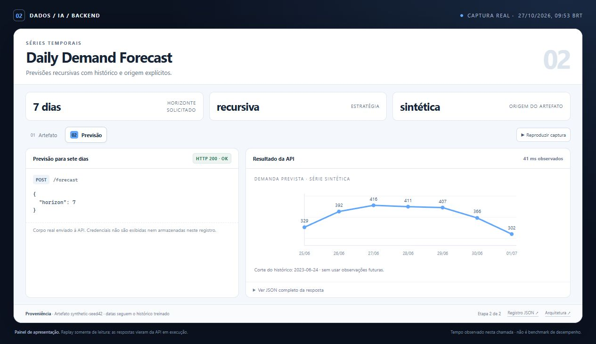
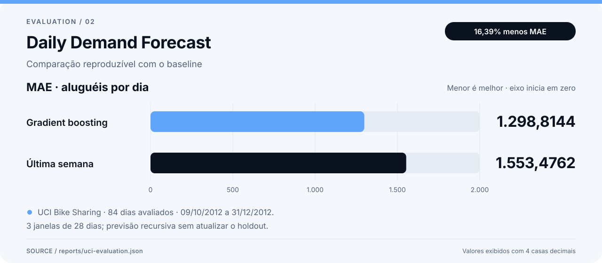

# Demonstração — Daily Demand Forecast

O painel de demonstração mostra o backend por meio de respostas reais da API, coletadas em uma execução local. O screenshot e a animação são capturas desse painel renderizado no navegador.



[Ver animação](assets/demo.gif) · [Abrir o painel local](demo/index.html) · [Inspecionar o registro bruto](demo/run.json) · [Voltar ao README](../README.md)

## O que observar

- Uma solicitação de horizonte retorna datas futuras e demanda estimada.
- Os metadados identificam o período e a origem da série usada no artefato da API.
- O gráfico de avaliação compara o modelo e o baseline sob o mesmo corte temporal.

## Dados e evidências

A API padrão do container usa a série sintética incluída. A avaliação offline também foi executada com os 731 dias da base pública UCI Bike Sharing. Os gráficos e relatórios identificam esses dois experimentos separadamente; os resultados UCI não são apresentados como uma medição da série sintética da API.

Relatório técnico complementar: [resultado registrado](../reports/uci-evaluation.json).

`demo/run.json` conserva requests, respostas HTTP, códigos de status, duração e verificações de cada etapa. A seção `supporting_evidence` identifica os relatórios offline associados, incluindo seus hashes. Valores de avaliações anteriores continuam identificados como relatórios registrados, separados das respostas HTTP da execução capturada.



MAE no recorte UCI registrado. A comparação sintética, em que o baseline venceu, também está preservada no README. Fonte: [relatório registrado](../reports/uci-evaluation.json).

## Registro da captura

| Informação | Origem |
| --- | --- |
| Início da execução, UTC | `2026-10-27T12:53:34.032708+00:00` |
| Fim da execução, UTC | `2026-10-27T12:53:34.089228+00:00` |
| Respostas e verificações | [demo/run.json](demo/run.json) |
| Painel com dados incorporados | [demo/index.html](demo/index.html) |
| Captura no navegador | [assets/screenshot.jpg](assets/screenshot.jpg) |
| Fluxo animado | [assets/demo.gif](assets/demo.gif) |
| Swagger: captura adicional independente | [assets/api-docs.jpg](assets/api-docs.jpg) |

Os timestamps acima pertencem à coleta da API. A imagem e o GIF documentam a apresentação desses dados no navegador. Abrir o HTML preserva o registro capturado; novas chamadas à API exigem o ambiente em execução.

A captura adicional do Swagger mostra uma requisição executada no navegador e sua resposta HTTP 200. Essa chamada é independente; o JSON acima corresponde à coleta usada no painel e no GIF.

## Reproduzir

Siga o setup no [README](../README.md) e execute, na raiz deste projeto:

```powershell
demand-forecast evaluate --data data/demo.csv --source synthetic-seed42
demand-forecast train --data data/demo.csv --source synthetic-seed42
demand-forecast predict --horizon 7
uvicorn demand_forecast.api:app --host 127.0.0.1 --port 8002
```

A API usa a porta `8002`. Os exemplos HTTP e as configurações de ambiente estão no README. O painel local pode ser aberto pelo arquivo `docs/demo/index.html`, que incorpora os dados capturados e permite percorrer as etapas sem consultar os serviços.

O screenshot facilita a leitura inicial; o JSON, os testes e os comandos permitem verificar o comportamento apresentado. Uma execução capturada documenta aquele cenário e ambiente, com os limites de dados descritos neste projeto.
